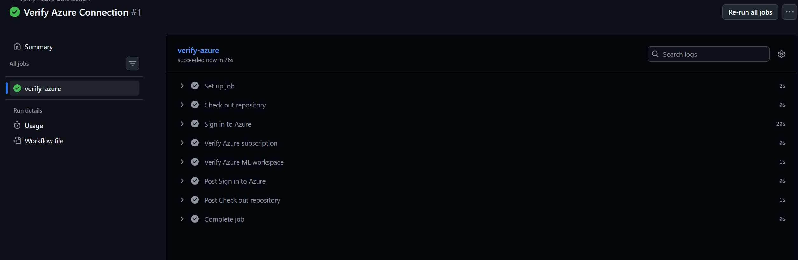
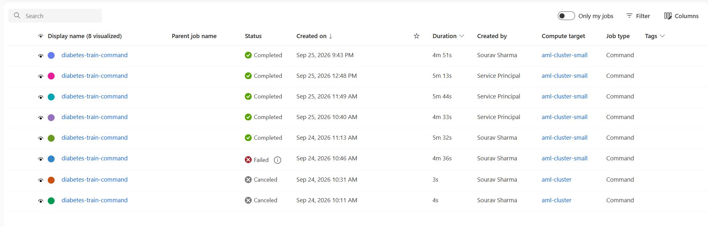
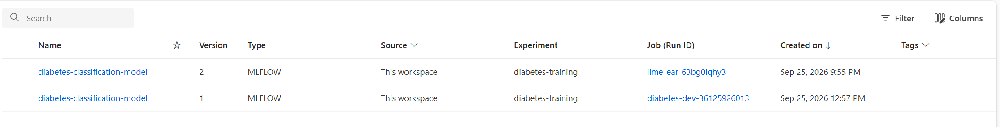
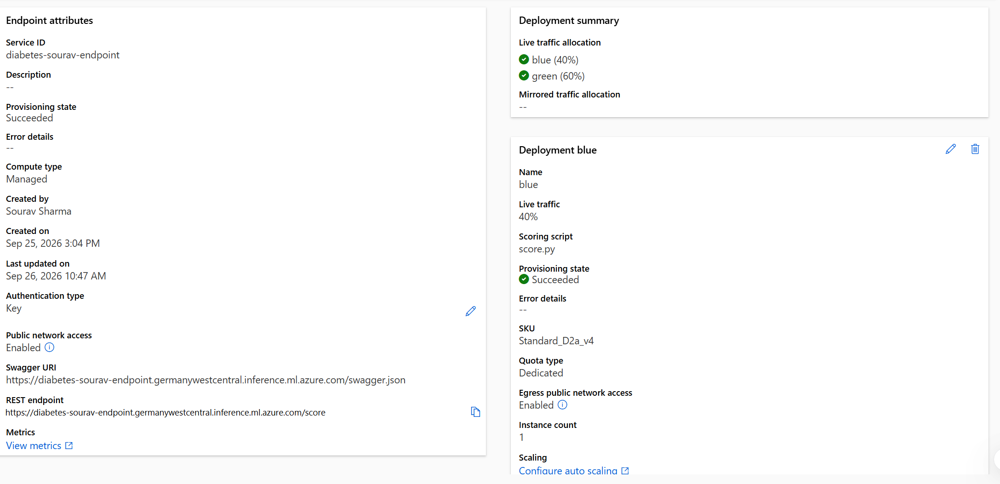
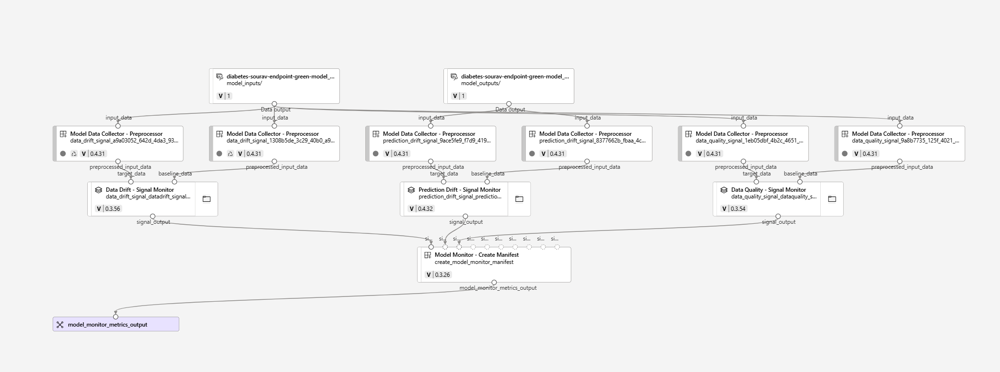

# AI-300 MLOps Hands-On Lab

Hands-on Azure Machine Learning work completed while preparing for the **Microsoft Certified: Machine Learning Operations Engineer Associate (AI-300)** certification.

This repository documents practical exercises across the MLOps lifecycle, including managed training jobs, MLflow model versioning, CI/CD connectivity, managed online deployment, traffic splitting, and model monitoring.

> **Scope:** This is a learning and hands-on lab repository. It demonstrates workflows I implemented during AI-300 preparation; it is not presented as a production system.

---

## MLOps Workflow

```text
Source / Configuration
        ↓
GitHub Actions / Azure Authentication
        ↓
Azure ML Training Jobs
        ↓
Experiment Tracking + MLflow
        ↓
Model Registration / Versioning
        ↓
Managed Online Endpoint
        ↓
Blue-Green Traffic Allocation
        ↓
Model Monitoring
```

---

## What I Practiced

### 1. CI/CD and Azure Connectivity

I used GitHub Actions to validate connectivity to Azure and the Azure Machine Learning workspace as part of the automation workflow.



**Practiced:**
- GitHub Actions workflow execution
- Azure authentication from CI/CD
- Azure subscription and workspace verification
- Moving ML operations away from manual-only portal workflows

---

### 2. Managed Azure ML Training Jobs

Training was submitted as Azure Machine Learning command jobs and executed on managed compute rather than being limited to local notebook execution.



**Practiced:**
- Azure ML command jobs
- Managed compute targets
- Repeatable remote execution
- Iterative debugging and rerunning jobs
- Experiment organization

---

### 3. Model Registration and Versioning with MLflow

Successful training runs were used to register versioned MLflow models in the Azure Machine Learning workspace.



**Practiced:**
- MLflow model packaging
- Model registration
- Explicit model versions
- Linking registered models to training runs
- Maintaining traceability between experimentation and deployment

---

### 4. Managed Online Deployment and Blue-Green Traffic Splitting

I deployed multiple model versions behind a managed online endpoint and configured live traffic between **blue** and **green** deployments.



The screenshot shows a staged rollout with traffic split between the two deployments, demonstrating how a new model version can be introduced gradually while retaining the previous deployment for rollback.

**Practiced:**
- Managed online endpoints
- Multiple deployments behind one endpoint
- Blue-green deployment strategy
- Traffic allocation between model versions
- Staged rollout and rollback concepts

---

### 5. Model Monitoring

I configured Azure Machine Learning model monitoring workflows covering signals such as **data drift, prediction drift, and data quality**.



**Practiced:**
- Data collection for deployed models
- Data drift monitoring
- Prediction drift monitoring
- Data quality monitoring
- Connecting monitoring signals to the wider model lifecycle

---

## Repository Structure

```text
.
├── .github/
│   └── workflows/              # CI/CD automation
├── deployment/                 # Endpoint/deployment configuration
├── environment/                # Runtime and dependency definitions
├── monitoring/                 # Monitoring configuration
├── src/                        # Training/supporting Python code
├── docs/
│   └── images/                 # README screenshots
└── README.md
```

Keep all README screenshots inside:

```text
docs/images/
```

Recommended filenames:

```text
docs/images/
├── github-actions-azure-connection.png
├── aml-training-jobs.png
├── aml-model-versions.png
├── aml-blue-green-deployment.png
└── aml-model-monitoring.png
```

---

## Technologies and Tools

- **Azure Machine Learning**
- **Python**
- **MLflow**
- **Azure CLI**
- **GitHub Actions**
- **YAML**
- **Managed Azure ML compute**
- **Azure ML managed online endpoints**
- **Model monitoring**
- **Azure identity / RBAC concepts**

---

## Example Azure ML Job Configuration

The repository contains YAML-based Azure ML job definitions that separate the training code, data inputs, environment, compute target, and experiment configuration.

```yaml
$schema: https://azuremlschemas.azureedge.net/latest/commandJob.schema.json

code: .

command: >-
  python train-model-parameters.py
  --training_data ${{inputs.training_data}}
  --reg_rate ${{inputs.reg_rate}}
  --metrics_output ${{outputs.metrics_output}}

inputs:
  training_data:
    type: uri_folder
  reg_rate: 0.01

outputs:
  metrics_output:
    type: uri_folder
```

This structure makes training execution more reproducible than relying only on manually executed notebook cells.

---

## Key Takeaways

Working through these labs helped connect individual Azure ML services into one MLOps lifecycle:

- Notebook experimentation and production-style execution serve different purposes.
- Managed jobs make training repeatable and auditable.
- MLflow provides traceability between runs, metrics, artifacts, and model versions.
- Versioned models make controlled promotion and rollback possible.
- A single endpoint can host multiple deployments for staged rollout.
- Monitoring is part of the ML lifecycle rather than a post-deployment afterthought.
- CI/CD can automate interaction with Azure ML instead of relying entirely on manual portal operations.

---

## Relation to AI-300

This repository was created while preparing for the:

**Microsoft Certified: Machine Learning Operations Engineer Associate (AI-300)**

The exercises support topics including:

- Azure Machine Learning infrastructure
- Managed training and experimentation
- MLflow tracking and model versioning
- CI/CD
- Model deployment
- Blue-green rollout
- Monitoring and lifecycle management

---

## Learning Context

Some exercises and patterns in this repository were based on Microsoft Learn / Microsoft Learning material used during AI-300 preparation.

The repository documents my own hands-on execution, configuration, troubleshooting, and understanding of those workflows.

Official Microsoft learning repository:

https://github.com/MicrosoftLearning/mslearn-mlops

---

## Security Note

Before publishing Azure screenshots or configuration, verify that the repository does **not** expose:

- Subscription or tenant IDs
- Client secrets
- Storage account keys
- SAS tokens
- Connection strings
- Personal access tokens
- `.env` files
- Credentials embedded in YAML
- Sensitive endpoint details

The deployment screenshot used in this README contains endpoint metadata but no authentication secret. If the endpoint is still active, consider cropping or masking the REST/Swagger URL before publishing.

---

## Next Steps

Potential extensions:

- Add automated tests and validation gates to CI/CD
- Add explicit dev/test/prod promotion stages
- Implement monitoring-triggered retraining
- Add infrastructure-as-code for reproducible Azure resources
- Add deployment validation and automated rollback logic
- Extend the repository with a small end-to-end project built independently from the lab material

---

## Author

**Sourav**

M.Sc. Computational Mechanics — Technical University of Munich  
Interested in Scientific Machine Learning, AI for Engineering, MLOps, and production ML systems.
